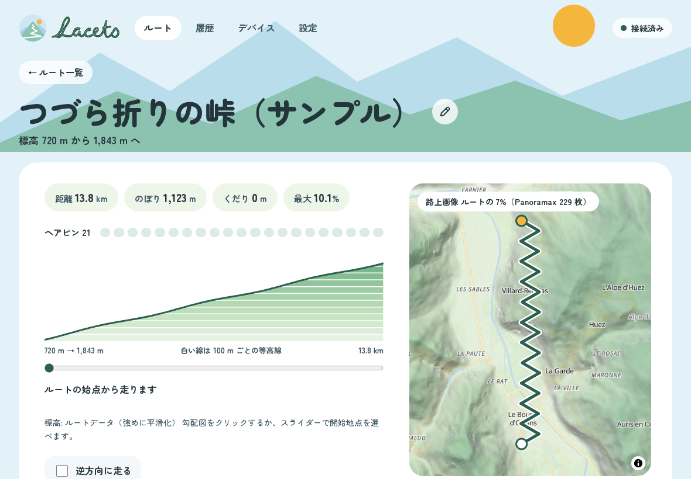
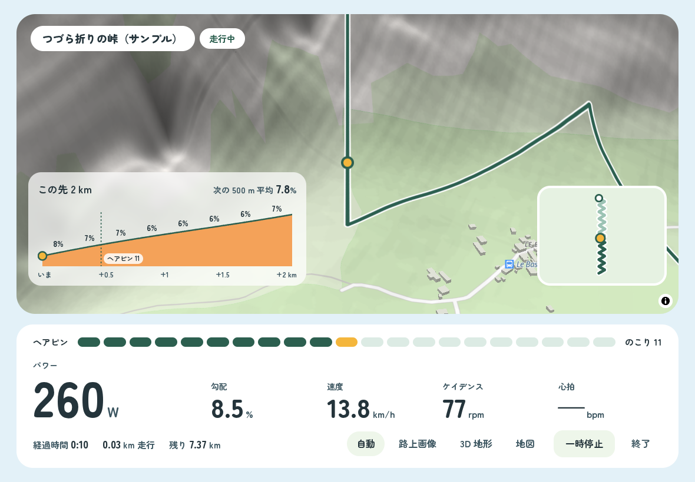

# Lacets

 

**行ってみたい峠を、部屋のスマートトレーナーで。**

Lacets（ラセ）は、ラルプデュエズのつづら折りや富士ヒルのような実在のルートを、スマートトレーナーの上で「実際に走っているかのように」再現するインドアサイクリング Web アプリです。名前はラルプデュエズの 21 のつづら折り（les lacets）から。

## できること

- **いつものルートをそのまま走る**：Strava などから書き出した GPX / TCX / FIT を取り込むだけ。途中から走り始めたり、逆方向に走ったりもできます
- **坂がちゃんと重くなる**：ルートの勾配をトレーナーの負荷として再現します（SIM モード）。速度はトレーナーの数字ではなく、体重・空気抵抗・路面からアプリが計算します
- **景色の中を進む**：走っている位置の路上画像（Panoramax / Mapillary）、3D の地形、地図を切り替えて表示します
- **先が見える**：ヘアピンの印で進み具合が、「この先 2 km」の勾配図で次の坂の強さがわかります
- **去年の自分と競う**：実走の FIT や過去の走行をゴーストにして、差を秒で表示。走ったあとは登り・1 km ごとに比べられ、自己ベストもわかります
- **記録を持ち出す**：走行を FIT で書き出し、Strava や Garmin Connect に手動でアップロードできます

画面は架空のサンプルルート。地図 © OpenFreeMap © OpenMapTiles © OpenStreetMap contributors、標高 Terrain Tiles（Mapzen ほか）

## 必要なもの

|                    |                                                                                                |
| ------------------ | ---------------------------------------------------------------------------------------------- |
| スマートトレーナー | Bluetooth FTMS に対応したもの（Wahoo KICKR Core 2 で確認）。変速は自転車の実際の変速で行います |
| 心拍計             | あれば（Bluetooth の心拍計）                                                                   |
| パソコン           | Windows / Mac の **Chrome または Edge**                                                        |
| iPad               | Web Bluetooth に対応したブラウザ **Bluefy**（iPad アプリ版は準備中）                           |

Safari は Web Bluetooth に対応していないため使えません。Zwift Cog / Click などのバーチャルシフトには対応していません。

## データの扱い

- ルート・走行記録・設定は、**使っている端末の中（ブラウザ）にだけ**保存します。Lacets のサーバーには送りません
- 端末を変えるときは、設定画面の「データの引っ越し」でバックアップを書き出して取り込みます
- 路上画像や地図のキー（Mapillary・MapTiler）は、使う人がそれぞれ設定画面で入力します

## いまの状況

自転車仲間で試すベータ版の準備中です（[ロードマップ](docs/03-roadmap.md)）。

開発に参加する方は [開発環境](docs/08-development.md) と [`CLAUDE.md`](CLAUDE.md)、設計は [`docs/`](docs/) を見てください。
