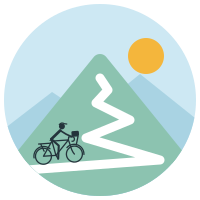

# Lacets

<p> </p>

実在のルートを、スマートトレーナー上で「実際に走っているかのように」再現するインドアサイクリング Web アプリ。
設計・計画は [`CLAUDE.md`](CLAUDE.md) と [`docs/`](docs/) を参照。

## 開発環境

- Node.js 24（`.nvmrc`。Vite 8 は Node 20.19+ / 22.12+ が必要）

```sh
nvm use
npm ci
npm run dev          # 開発サーバー（?sim=1 でシミュレータトレーナー ※M1 で実装）
npm test             # ユニットテスト（Vitest）
npm run e2e          # E2E テスト（Playwright）
npm run lint         # ESLint + Prettier チェック
npm run typecheck
npm run format       # Prettier で整形
```

E2E では WebGL を無効にしている（GPU のない環境で地図の描画がページを固めるほど重いため）。地図・3D 地形の見た目は実機で確認する。外部の路上画像 API は `e2e/fixtures.ts` でモックしている。

E2E の初回は `npx playwright install chromium` でブラウザを入れる。
Linux / WSL で共有ライブラリ不足（`libgbm.so.1` 等）のエラーが出る場合は `sudo npx playwright install-deps chromium` を実行する。

### 環境変数（任意）

| 変数                 | 内容                                                |
| -------------------- | --------------------------------------------------- |
| `VITE_MAP_STYLE_URL` | MapLibre の地図スタイル URL。未指定なら OpenFreeMap |

Mapillary のトークンと MapTiler のキーは、各自がアプリの設定画面で入力する（端末内にのみ保存）。

### テスト用ルート

`test/fixtures/synthetic-lacets.gpx` は架空の 21 ヘアピン・13.8 km の登り（`node scripts/generate-synthetic-lacets.mjs` で再生成）。`?sim=1` で取り込んで走行を試せる。
